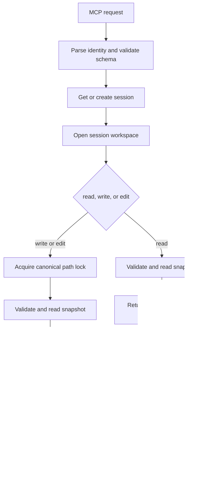
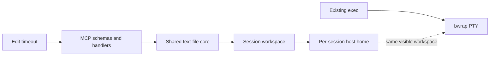

# feat: Add read, write, and edit MCP file tools

## Summary

Add `read`, `write`, and `edit` as MCP file tools while keeping `exec` unchanged, giving agents four focused capabilities: inspect files, replace whole files, apply precise edits, and run shell commands. The three file tools will share one workspace boundary, text validation policy, path lock, and atomic persistence path.

## Feasibility and Complexity

**Verdict:** Feasible. The implementation fits the current MCP and session architecture without a service redesign.

**Overall complexity:** Medium-high for a production-quality release. `read` and `write` are straightforward; `edit` accounts for most of the risk because normalization, uniqueness diagnostics, overlapping edits, line-ending restoration, diff generation, and atomicity interact.

| Scope | Complexity | Main drivers | Rough senior-engineer effort |
|------|------------|--------------|-------------------------------|
| Workspace access and path safety | Medium | Workspace mapping, symlink containment, per-path locking | 3–4 days |
| `read` | Low | Range handling, UTF-8 validation, structured output | 1–2 days |
| `write` | Medium | Create/overwrite semantics, mode preservation, atomic replacement | 2–3 days |
| `edit` | High | Exact and normalized matching, offset integrity, overlap detection, diagnostics | 5–7 days |
| MCP contracts and integration | Medium | Schemas, structured errors, config wiring, end-to-end tests | 2–3 days |
| **Total** |  |  | **13–19 days** |

A narrow internal prototype can land faster, but it should not be treated as production-ready until the exact-match, rollback-on-error, path-escape, cancellation, and concurrent-write scenarios are covered.

---

## Problem Frame

Agents currently use `exec` to inspect and mutate files, which makes modifications dependent on shell quoting and utilities such as `sed`, heredocs, and redirection. These operations are difficult to audit, can leave partial files, and invite accidental formatting or encoding changes.

The source requirement defines `edit` as a precise replacement primitive. Adding `read` and `write` completes the normal file workflow: read the source, choose targeted replacement or full rewrite, and verify the result. The shell remains available for commands that are not file operations.

---

## Requirements

- R1. Expose exactly four MCP tools: `exec`, `read`, `write`, and `edit`.
- R2. Keep `exec` behavior and its HTTP surface unchanged.
- R3. File tools operate on the session's persistent writable workspace. Relative paths resolve from the workspace root, and absolute paths must identify `/root` or a descendant.
- R4. `read` returns exact text and optional 1-based line-range information without adding line-number prefixes to the returned content.
- R5. `write` creates or overwrites a text file, does not create missing parent directories, and replaces the destination atomically.
- R6. `edit` supports one or more exact text replacements against a single source snapshot; empty input, missing matches, duplicate matches, overlaps, no-op replacements, and non-file targets are explicit tool errors.
- R7. When exact matching fails, `edit` applies the bounded normalization rules from the origin document and reports the resulting diff. The fallback is deterministic and never silently chooses among duplicate matches.
- R8. `edit` preserves a UTF-8 BOM and restores the source's CRLF or LF style.
- R9. All file tools reject non-UTF-8 text, binary content, non-regular targets, paths that escape the workspace, and files over 4 MiB.
- R10. `write` and `edit` serialize calls targeting the same canonical file while allowing unrelated paths to proceed independently.
- R11. Cancellation is checked before any atomic replacement. A canceled or failed mutation leaves the previous file intact.
- R12. Successful mutations return structured details plus human-readable text; `edit`, and `write` when replacing existing text, include a line diff and unified patch with 4 lines of context.
- R13. The implementation follows existing MCP identity parsing, automatic session creation, and Go error propagation conventions.

**Origin decisions carried forward:** precise replacement semantics, camelCase edit parameters, bounded normalization, 4 MiB limit, UTF-8 BOM and line-ending preservation, per-path serialization, and the independent `STRATA_SERVER_EDIT_TIMEOUT` setting.

---

## Scope Boundaries

- Do not add HTTP or gRPC endpoints for file operations.
- Do not change `exec` argument handling or shell output behavior.
- Do not provide multi-file edits, regular-expression replacement, globbing, formatting, linting, encoding conversion, or directory operations.
- Do not expose the full bwrap namespace, `/proc`, `/dev`, `/tmp`, or host system paths through file tools.
- Do not automatically create parent directories for `write`.
- Do not implement binary reads or writes.
- Do not add a user-configurable switch for omitting unified patches.

### Deferred to Follow-Up Work

- Multi-file edits and batch file transactions.
- A configurable patch-size threshold or patch suppression option.
- A future namespace-aware backend if file tools must inspect the exact live bwrap mount view instead of the persistent workspace.
- File-operation HTTP or gRPC APIs for non-MCP clients.

---

## Context & Research

### Relevant Code and Patterns

- `pkg/mcp/tools.go` owns tool registration and currently defines only `exec`.
- `pkg/mcp/handler.go` already performs identity parsing, timeout selection, and automatic session acquisition.
- `pkg/identity/identity.go` provides the shared `owner_id` / `session_id` parsing path.
- `pkg/sandbox/session.go` creates `home`, `upper`, `work`, and `merged`, then binds session `home` to sandbox `/root`.
- `pkg/sandbox/manager.go` owns `GetOrCreate` and session lifecycle.
- `pkg/config/config.go` uses envconfig and is the appropriate place for the independent edit timeout.
- `pkg/webapi/exec.go` is the existing shell adapter and will remain untouched.
- Go 1.25 provides `os.Root`, which can constrain file operations beneath a directory while following only in-root symlinks.
- `github.com/mark3labs/mcp-go/mcp` provides `NewToolResultStructured` for structured details and fallback text.

### Institutional Learnings

No relevant material exists under `docs/solutions/`.

### External References

No external research is required. The repository has a direct MCP pattern, Go standard-library support for sandboxed root traversal, and the origin document already fixes the edit behavior.

---

## Key Technical Decisions

| Decision | Choice | Rationale |
|----------|--------|-----------|
| File-tool path model | Session workspace only | Host-side file access cannot faithfully reproduce ephemeral bwrap mounts such as `/tmp`, `/proc`, and temporary overlay views. A stable `/root` workspace gives predictable persistence and keeps `exec` available for the full namespace. |
| Containment | Open the workspace with `os.Root` and resolve symlinks inside it | This uses standard-library protections against `..` and symlink escape instead of duplicating path-containment logic. |
| Text policy | UTF-8 text only, maximum 4 MiB | Preserves reliable JSON transport and bounded memory use while matching the origin document. |
| `read` range contract | Optional `start_line` and `line_count`, both 1-based where applicable | This supports targeted reads without imposing a default page size. Returned content remains copy-safe because line-number prefixes are excluded. |
| `write` transaction | Temporary file in the destination directory, file sync, rename, directory sync | Same-directory rename is atomic on the supported filesystem and avoids leaving truncated destinations. |
| `write` path creation | Create the final file, but require its parent directory to exist | This avoids hidden directory-tree creation while still supporting new files. |
| `edit` matching | Exact search first; normalized search only when an exact match is unavailable | Preserves byte-exact behavior for normal calls and limits normalization surprises to the fallback path. |
| `edit` normalized baseline | Re-match all edits against one normalized view when fallback is required | This keeps every offset on one coordinate system and prevents mixed raw/normalized offsets. |
| Diff generation | Use `github.com/pmezard/go-difflib/difflib` and emit unified patches without timestamps | Diff generation is mechanical and should not become a bespoke parser inside the MCP layer. |
| Lock scope | Canonical target path within the session workspace | Prevents lost updates between `write` and `edit` without serializing independent files. |
| Timeout | Add `STRATA_SERVER_EDIT_TIMEOUT`, default `30s`, only for `edit` | Carries the origin decision and avoids needless configuration for bounded read/write operations. |

---

## Open Questions

### Resolved During Planning

- Which root do file tools expose? The persistent session `home` workspace, corresponding to sandbox `/root`.
- Does `read` support ranges? Yes, via optional `start_line` and `line_count`.
- Can `write` create files? Yes. It does not create parent directories.
- Is `write` atomic? Yes, through same-directory temporary-file replacement.
- What happens when one edit needs normalization? All edits are re-evaluated against the normalized snapshot so offsets remain coherent.
- Does `exec` gain new validation or file logic? No.

### Deferred to Implementation

- Exact helper and type names inside `pkg/mcp`.
- Whether a narrowly scoped test seam is needed to simulate a rename or sync failure.
- The precise internal layout of normalized-offset diagnostics after matching.

---

## High-Level Technical Design

> This illustrates the intended approach and is directional guidance for review, not implementation specification. The implementing agent should treat it as context, not code to reproduce.

The file tools remain transport adapters around a shared text-file core. `exec` stays on its current path and does not participate in the file-tool lock unless a future requirement explicitly adds shell/file coordination.

---

## Implementation Units

### U1. Establish the session workspace and safe file-access core

**Goal:** Give MCP file handlers one constrained workspace and one canonical-path model.

**Requirements:** R3, R9, R10, R11, R13

**Dependencies:** None

**Files:**
- Modify: `pkg/sandbox/session.go`
- Modify: `pkg/sandbox/session_extra_test.go`
- Create: `pkg/mcp/file_access.go`
- Create: `pkg/mcp/file_access_test.go`

**Approach:**
- Expose the session's host `home` directory through a small read-only session method; do not expose overlay internals.
- Translate relative paths from the workspace root. Translate `/root` and descendants to workspace-relative paths. Reject other absolute paths and `..` escape attempts.
- Open the workspace with `os.Root`. Resolve an existing symlink target inside the workspace before mutation so replacing a symlink edits its in-root target rather than replacing the link.
- Reject absolute symlinks and symlinks resolving outside the workspace.
- Add a keyed path locker owned by the MCP handler. Include the canonical workspace path in the key and release map entries when their reference count reaches zero.
- Acquire the path lock before reading a mutation snapshot; a lock acquired only before rename would still allow lost updates between concurrent read-modify-write calls.
- Centralize text loading, regular-file validation, UTF-8 validation, NUL/binary detection, and the 4 MiB limit for reuse by all three tools.

**Patterns to follow:**
- `pkg/sandbox/session.go` session-owned state and methods.
- `pkg/identity/identity.go` explicit error returns.
- Standard library `os.Root` rather than hand-built prefix checks.

**Test scenarios:**
- Happy path: relative `notes.txt` and absolute `/root/notes.txt` resolve to the same workspace file.
- Happy path: a relative symlink to another file inside the workspace is readable and editable without replacing the link itself.
- Edge case: a missing final component is accepted for `write` when its parent exists.
- Error path: `../outside.txt`, `/tmp/outside.txt`, an absolute symlink, and a symlink to a host path outside the workspace are rejected before I/O.
- Error path: a directory, device, or unsupported file type returns the documented non-file error.
- Error path: invalid UTF-8, embedded NUL, and content over 4 MiB are rejected.
- Concurrency: two lock acquisitions for different paths proceed independently, while the same canonical path waits.

**Verification:**
- All file tools can share the resolver and loader without duplicating containment checks.
- No path or symlink input can access a host path outside the session workspace.

---

### U2. Implement the `read` tool

**Goal:** Return exact file text, optionally limited to a 1-based line range, with structured range metadata.

**Requirements:** R1, R4, R9, R13

**Dependencies:** U1

**Files:**
- Create: `pkg/mcp/file_read.go`
- Create: `pkg/mcp/file_read_test.go`

**Approach:**
- Accept required `path`, optional `start_line`, and optional `line_count`. Both optional values must be positive integers.
- Default to the entire file. Clamp the requested end to EOF and report the actual returned start/end lines and total line count.
- Return file content without inserted line numbers so agents can reuse text directly in `edit.oldText`.
- Strip a leading UTF-8 BOM from returned content and expose that fact in structured details.
- Return `has_bom`, `line_ending`, `start_line`, `end_line`, `total_lines`, and `path` in structured content.

**Patterns to follow:**
- MCP tool errors with `mcp.NewToolResultError`.
- Structured success through `mcp.NewToolResultStructured`.

**Test scenarios:**
- Happy path: a three-line file with no range returns all three exact lines and correct metadata.
- Happy path: `start_line: 2, line_count: 1` returns only line 2 and correct actual bounds.
- Edge case: a range starting at EOF returns empty content with valid metadata.
- Edge case: a file with CRLF and a UTF-8 BOM returns copyable text, reports CRLF, and does not emit a BOM into the text body.
- Error path: zero/negative range values, a missing file, a directory, binary content, and a file over 4 MiB return tool errors.

**Verification:**
- Content returned by `read` can be passed unchanged as `edit.oldText` for an exact edit.

---

### U3. Implement the `write` tool with atomic replacement

**Goal:** Create or replace one text file without partial writes and with predictable path behavior.

**Requirements:** R1, R5, R9, R10, R11, R12, R13

**Dependencies:** U1

**Files:**
- Create: `pkg/mcp/file_write.go`
- Create: `pkg/mcp/file_write_test.go`

**Approach:**
- Accept required `path` and `content`; empty content is valid and creates an empty file or truncates an existing one.
- Require the parent directory to exist. Return a creation error for a missing parent rather than calling `MkdirAll`.
- Preserve the existing file mode on overwrite and use `0644` for new files, subject to the process umask.
- Resolve an in-workspace file symlink to its target and atomically replace the target.
- Acquire the canonical target lock before reading the prior content or detecting whether the target exists.
- Write to a uniquely named temporary file in the destination directory, sync it, rename it over the destination, then sync the directory.
- Check the context before creating the temporary file, before rename, and after any operation that can detect cancellation.
- Return structured metadata for `path`, `created`, `bytes_written`, and whether the content changed. Include diff and patch details when replacing existing text.

**Patterns to follow:**
- `os.Root.OpenFile`, `os.Root.Rename`, and `os.Root.Chmod` for containment-aware filesystem operations.
- Existing Go error wrapping style with operation context.

**Test scenarios:**
- Happy path: write a new file in an existing directory; content and `0644` mode are correct.
- Happy path: overwrite an existing file while preserving its custom mode.
- Happy path: empty content truncates an existing file and succeeds without reporting a no-op error.
- Edge case: writing identical content returns success with `changed: false`.
- Error path: a missing parent directory, a directory destination, a path outside the workspace, invalid UTF-8, and oversized content leave the filesystem unchanged.
- Error path: cancellation before rename leaves the original file unchanged and removes the temporary file.
- Integration: overwriting an in-workspace symlink updates the target and leaves the symlink in place.

**Verification:**
- Interrupting or failing before rename never exposes a partially written destination.

---

### U4. Implement `edit` matching, validation, and atomic application

**Goal:** Apply one or more unique, non-overlapping replacements against one source snapshot and reject ambiguity.

**Requirements:** R1, R6, R7, R8, R9, R10, R11, R12, R13

**Dependencies:** U1, U3

**Files:**
- Create: `pkg/mcp/file_edit.go`
- Create: `pkg/mcp/file_edit_test.go`
- Modify: `go.mod`
- Modify: `go.sum`

**Approach:**
- Normalize tool arguments into one edit list, supporting the documented legacy top-level pair, JSON-string array, and single-object forms while documenting camelCase as canonical.
- Validate `path`, non-empty `edits`, and non-empty `oldText` before opening the file.
- Resolve the canonical target and acquire its lock before reading the source snapshot.
- Strip the UTF-8 BOM and detect the first line-ending style before matching. Restore the original style and BOM when writing.
- Attempt byte-exact matching against the original text first. If every edit matches uniquely, apply edits from the end of the file toward the beginning.
- If any edit lacks an exact match, build one normalized view with the bounded origin rules, normalize each `oldText` for matching, and re-match every edit against that view. Normalize line endings in `newText` to the detected source style, but do not apply character or trailing-whitespace normalization to the replacement content.
- Detect duplicate matches and report up to five 1-based line diagnostics. Detect overlapping ranges and identify both edit indexes.
- Reject a final result identical to the source.
- Apply all edit validation against the locked snapshot, then reuse the atomic writer from U3.
- Return structured `path`, `diff`, `patch`, and optional `first_changed_line`.

**Patterns to follow:**
- Origin document error wording and parameter-normalization rules.
- U3's atomic persistence path.

**Test scenarios:**
- Happy path: a unique exact replacement updates only the target text and reports the correct first changed line.
- Happy path: two disjoint replacements in one call apply against the original snapshot.
- Edge case: an empty `newText` deletes the matched text.
- Edge case: a CRLF file remains CRLF, and a UTF-8 BOM file remains BOM-prefixed.
- Fallback: curly quotes, non-breaking spaces, trailing whitespace, and line-ending differences are matched through normalization.
- Fallback: character normalization applies to `oldText` for matching but does not rewrite `newText` beyond line-ending restoration.
- Edge case: differing leading indentation does not match through the fallback.
- Compatibility: top-level `oldText` / `newText`, a JSON-string `edits` value, and a single-object `edits` value normalize into the same internal edit list.
- Error path: missing `oldText`, zero edits, missing match, duplicate match, overlapping edits, and a no-op replacement all return the specified tool errors without changing the file.
- Error path: a path pointing to a directory or outside the workspace is rejected before an atomic write.
- Concurrency: concurrent edits to the same file serialize and neither update is lost.
- Cancellation: cancellation before replacement leaves the original file byte-identical.

**Verification:**
- Every failed validation leaves both the source file and directory contents unchanged except for temporary files that are cleaned up.
- Duplicate and overlap diagnostics identify the edits precisely enough for an agent to correct its request.

---

### U5. Register the MCP tools and wire configuration

**Goal:** Expose the four-tool MCP surface with accurate schemas, result types, and edit timeout configuration.

**Requirements:** R1, R2, R12, R13

**Dependencies:** U2, U3, U4

**Files:**
- Modify: `pkg/mcp/tools.go`
- Modify: `pkg/mcp/handler.go`
- Modify: `pkg/config/config.go`
- Modify: `pkg/config/config_test.go`
- Modify: `cmd/run.go`
- Create: `pkg/mcp/handler_test.go`

**Approach:**
- Add `read`, `write`, and `edit` schemas with clear camelCase descriptions and required fields. Mark `read` as non-destructive and mutation tools as destructive.
- Keep `exec` schema and handler behavior unchanged.
- Extend the handler with an edit timeout and shared path locker.
- Parse identity through `identity.ParseScarf(ctx, identity.FromArgs(args))` for each new handler and acquire the session through `manager.GetOrCreate`.
- Add `STRATA_SERVER_EDIT_TIMEOUT` with a `30s` default and pass it during server construction.
- Fail configuration loading when an explicitly supplied edit timeout is non-positive.
- Return protocol-level errors only for exceptional handler failures; return tool errors for validation and filesystem failures.

**Patterns to follow:**
- Existing `SetupTools` registration in `pkg/mcp/tools.go`.
- Existing `handleExec` identity and session flow.
- `envconfig` tags and tests in `pkg/config`.

**Test scenarios:**
- Happy path: MCP tool discovery lists exactly `exec`, `read`, `write`, and `edit`.
- Integration: each file-tool handler rejects missing identity and accepts owner/session values from arguments or request context.
- Integration: file-tool calls auto-create a session through the same manager path as `exec`.
- Error path: invalid edit arguments return a tool result with `IsError` rather than an MCP protocol error.
- Edge case: a custom edit timeout is passed through configuration; an explicitly zero or negative value causes a clear configuration error.
- Integration: `exec` still accepts its existing arguments and returns text output.

**Verification:**
- Existing `exec` callers observe no schema or behavior regression.
- Tool descriptions make the workspace-only boundary explicit to agents.

---

### U6. Add integration coverage, documentation, and release checks

**Goal:** Prove the four tools work together and document the final contract.

**Requirements:** R1–R13

**Dependencies:** U5

**Files:**
- Modify: `README.md`
- Modify: `README.zh.md`
- Modify: `docs/edit-tool.md`
- Modify: `scripts/test-mcp.ts`
- Create: `pkg/mcp/file_tools_integration_test.go`

**Approach:**
- Add an end-to-end flow against a directly constructed temporary workspace: `write` a file, `read` it, `edit` a unique region, then `read` the result.
- Add negative integration cases for traversal, a no-op edit, and duplicate matches.
- Document all four tools, their argument shapes, workspace boundary, result details, and differences between file tools and shell behavior.
- Update the origin document to include the shared read/write contract and the session-workspace decision.
- Extend the MCP smoke script with successful and failing file-tool calls.

**Patterns to follow:**
- Table-driven Go tests used elsewhere in the repository.
- Existing shell-based MCP smoke-test structure.

**Test scenarios:**
- Integration: `write` creates a file, `read` returns exact content, `edit` changes one unique block, and the final `read` matches the expected text.
- Integration: `edit` receives content copied directly from `read` and succeeds without line-number cleanup.
- Error path: a traversal attempt is rejected consistently by all three file tools.
- Error path: a duplicate match reports diagnostic locations and leaves the file unchanged.
- Compatibility: on a Linux environment with bwrap available, `exec` can read the same workspace file from sandbox `/root`.

**Verification:**
- README and tool schemas describe the same semantics.
- A developer can exercise all four tools through the existing MCP test path.
- Host-independent file-tool tests do not silently skip behavior because bwrap is unavailable.

---

## System-Wide Impact

- **Interaction graph:** MCP registration calls the new handlers; handlers use identity, session management, workspace resolution, and atomic persistence. `exec` remains a separate path.
- **Error propagation:** Validation and filesystem failures become MCP tool-result errors. Unexpected handler or session failures also remain visible as tool errors with operation context.
- **State lifecycle risks:** Temporary files, open root descriptors, and path-lock entries must always be cleaned up. Session closure must not leave file-tool state pinned indefinitely.
- **API surface parity:** `exec` HTTP, gRPC, WebSocket, and MCP behavior remain unchanged. File tools are MCP-only.
- **Trust model:** File tools inherit the existing MCP identity and authorization model. They do not add a new privilege boundary because `exec` already grants equivalent workspace mutation; they must not bypass the workspace boundary or expose host paths unavailable to the session.
- **Integration coverage:** Unit tests cover parsing and transformations; integration tests must prove the `read` → `edit` → `read` workflow and shared `/root` visibility with `exec`.
- **Unchanged invariants:** Existing session creation, overlay fallback, identity priority, shell timeout behavior, and shell output truncation remain intact.

---

## Risks & Dependencies

| Risk | Likelihood | Impact | Mitigation |
|------|------------|--------|------------|
| File-tool workspace differs from the full shell namespace | High | Medium | Make the boundary explicit in schemas and docs; defer namespace-aware access as follow-up work. |
| A shell command mutates a file while `write` or `edit` is replacing it | Medium | High | Per-path locks cover MCP file tools only; document that `exec` remains outside this lock and rely on atomic replacement to avoid partial reads. |
| Normalized fallback changes untouched characters when it rewrites the normalized view | Medium | High | Restrict fallback to the documented bounded rules, return a full diff, and test the behavior explicitly. |
| Symlink replacement accidentally replaces the link instead of its target | Low | High | Resolve in-workspace targets before acquiring the write lock and use `os.Root` for final containment. |
| Atomic rename is unavailable or crosses filesystems | Low | High | Create the temporary file in the destination directory and surface rename/sync failures without modifying the destination. |
| Diff adds dependency and large-output cost | Medium | Medium | Use one small diff library, cap files at 4 MiB, emit only file-relative patch headers, and defer patch suppression. |
| Edits derived from different line-ending conventions fail unexpectedly | Low | Medium | Add explicit CRLF/LF tests and keep the returned `read` text copy-safe. |
| Tests may depend on Linux bwrap behavior on macOS development hosts | Medium | Medium | Keep matching and persistence tests host-independent by operating directly on temporary workspace roots; reserve bwrap checks for integration environments that provide it. |

---

## Documentation / Operational Notes

- Add the new timeout to configuration documentation and deployment examples.
- Document the four-tool MCP inventory and distinguish workspace-scoped file tools from full-shell `exec`.
- Document that `write` does not create parent directories and that `edit` requires unique, non-overlapping matches.
- Log filesystem failures at the MCP boundary with owner/session identifiers omitted from file content and args.
- No migration or rollout flag is required; the new tools are additive.

---

## Sources & References

- **Origin document:** [docs/edit-tool.md](../edit-tool.md)
- Related code: `pkg/mcp/tools.go`, `pkg/mcp/handler.go`, `pkg/config/config.go`, `pkg/sandbox/session.go`, `pkg/webapi/exec.go`
- Standard library: `os.Root` for containment-aware filesystem access
- MCP dependency: `github.com/mark3labs/mcp-go/mcp` structured tool results
