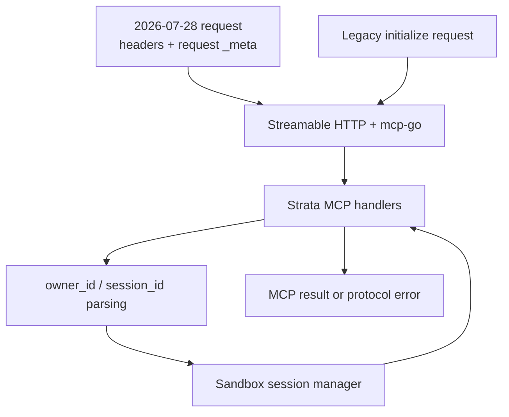

# refactor: Upgrade mcp-go for MCP 2026-07-28

## Summary

Upgrade `github.com/mark3labs/mcp-go` from `v0.45.0` to `v1.5.0`, make the Strata MCP endpoint exercise the stateless `2026-07-28` protocol, and preserve dual-era compatibility. Strata's application-level sandbox identity remains explicit through `owner_id` and `session_id`; only the MCP transport session is removed.

---

## Problem Frame

The current SDK predates the `2026-07-28` protocol revision. That revision removes the initialize handshake, `Mcp-Session-Id`, the standalone HTTP GET stream, DELETE-based session termination, and SSE resumption. It requires every request to carry its own protocol version and capabilities, and it requires standard HTTP metadata headers for routing and validation.

Strata already carries sandbox state through explicit `owner_id` and `session_id` values, so its application state model can remain intact. The gap is SDK currency and verification: the existing HTTP smoke test still uses the legacy initialize flow, while the Go test suite does not assert the modern Streamable HTTP contract.

---

## Requirements

- R1. Track the current stable MCP specification revision, `2026-07-28`.
- R2. Upgrade the direct MCP dependency to `github.com/mark3labs/mcp-go v1.5.0` and satisfy its Go language requirement.
- R3. Preserve Strata's `owner_id` / `session_id` sandbox lifecycle and identity precedence.
- R4. Serve modern Streamable HTTP requests without `initialize` or an MCP transport session.
- R5. Preserve compatibility with legacy initialize-based MCP clients supported by the upgraded SDK.
- R6. Add protocol-level HTTP coverage for modern request metadata, response metadata, errors, and removed session behavior.
- R7. Update the MCP smoke test and user-facing documentation so they describe the active protocol semantics accurately.
- R8. Keep the existing `exec`, `read`, `write`, and `edit` tool contracts and their sandbox behavior unchanged.

---

## Scope Boundaries

- Do not replace `mcp-go` with another MCP SDK.
- Do not remove Strata's application-level sandbox session or rename `owner_id` / `session_id`.
- Do not change identity priority, session creation, TTL cleanup, overlay behavior, or shell execution.
- Do not introduce server-minted session handles in this change.
- Do not add Tasks, Multi Round-Trip Requests, subscriptions, OAuth changes, or new MCP tools.
- Do not change REST, WebSocket, or gRPC API behavior.
- Do not remove legacy protocol support while the upgraded SDK continues to provide dual-era serving.

### Deferred to Follow-Up Work

- A protocol deprecation plan for legacy clients after real client compatibility data is available.
- A server-minted sandbox handle model if caller-supplied `owner_id` / `session_id` needs a separate product change.
- Adoption of MCP extensions such as Tasks, MRTR, or long-lived subscription streams.

---

## Context & Research

### Relevant Code and Patterns

- `pkg/mcp/handler.go` owns the MCP server, Streamable HTTP handler, and request-to-identity context bridge.
- `pkg/mcp/tools.go` owns the four-tool inventory and input schemas.
- `pkg/mcp/file_*.go` and their tests own tool-level file behavior and sandbox workspace access.
- `pkg/identity/identity.go` defines the application-level identity parsing path and custom `X-Owner-Id` / `X-Session-Id` headers.
- `pkg/sandbox/manager.go` and `pkg/sandbox/session.go` own sandbox session lifecycle.
- `scripts/test-mcp.ts` exercises the live HTTP endpoint and currently performs the legacy initialize sequence.
- `docs/plans/2026-11-12-001-feat-file-tools-plan.md` establishes the implementation-unit and test-scenario conventions for this repository.

### Institutional Learnings

No relevant material exists under `docs/solutions/`. The prior file-tools plan establishes the useful local pattern: protocol and handler behavior are tested close to the owning package, while the smoke script verifies the assembled service.

### External References

- MCP `2026-07-28` changelog: https://modelcontextprotocol.io/specification/2026-07-28/changelog
- Streamable HTTP transport: https://modelcontextprotocol.io/specification/2026-07-28/basic/transports/streamable-http
- Protocol versioning and dual-era compatibility: https://modelcontextprotocol.io/specification/2026-07-28/basic/versioning
- `mcp-go v1.5.0` release: https://github.com/mark3labs/mcp-go/releases/tag/v1.5.0
- `mcp-go v1.0.0`, which introduced `2026-07-28` support: https://github.com/mark3labs/mcp-go/releases/tag/v1.0.0

---

## Key Technical Decisions

| Decision | Choice | Rationale |
|----------|--------|-----------|
| SDK target | Pin `mcp-go v1.5.0` | The current stable release includes `2026-07-28` support plus transport and cancellation fixes. Existing Strata MCP code compiles against it without source changes in an isolated validation. |
| Protocol support | Serve modern and legacy clients concurrently | The specification permits dual-era servers, and the upgraded SDK supports this by default. This avoids turning an SDK upgrade into an immediate client-breaking release. |
| Session model | Keep Strata sandbox sessions; remove reliance on MCP transport sessions | Sandbox state is application state and remains explicit. Modern MCP requests do not use `Mcp-Session-Id`. |
| Identity transport | Keep args and custom business headers | `owner_id` / `session_id` and `X-Session-Id` are Strata-owned inputs, not the removed MCP session header. |
| Test seam | Add modern HTTP tests at the registered MCP handler | Tool unit tests do not prove header validation, per-request metadata, response metadata, or removed GET/DELETE behavior. |
| Live integration | Make modern protocol the smoke-test default and retain a legacy mode | The script remains responsible for exercising real sandbox tool calls, while the Go tests provide deterministic transport coverage without requiring bwrap. |
| Error boundary | Assert protocol errors and tool errors separately | Header/version failures are MCP protocol failures; invalid tool arguments remain `CallToolResult` errors visible to the model. |

---

## Open Questions

### Resolved During Planning

- Does `2026-07-28` remove all session-like behavior from Strata? No. It removes MCP transport sessions. Application-level identifiers passed with each request remain the supported mechanism for cross-request state.
- Is the current SDK outdated? Yes. The repository uses `v0.45.0`; `v1.5.0` is the current stable release and already supports the latest specification.
- Does the source need a broad MCP handler rewrite? No source change was required to compile and pass the existing suite against `v1.5.0`.
- Should the first release support legacy clients? Yes. Keep the SDK's dual-era behavior and verify both paths.

### Deferred to Implementation

- Whether `v1.5.0` exposes any edge-case mismatch with Strata's current handler configuration once the modern request tests are executed.
- The exact shared test helper shape for constructing modern and legacy HTTP requests.
- Whether the smoke script needs a command-line switch or an environment-variable switch for its legacy mode.

---

## High-Level Technical Design

> This illustrates the intended request flow and is directional guidance for review, not implementation specification. The implementing agent should treat it as context rather than code to reproduce.

Modern requests are self-describing and do not create a transport session. Legacy requests may still initialize a transport session. Both converge on the same Strata tool handlers and application-level sandbox identity path.

---

## Implementation Units

### U1. Upgrade the MCP dependency and build floor

**Goal:** Replace the stale MCP SDK and produce a reproducible module graph that builds the existing service.

**Requirements:** R2, R8

**Dependencies:** None

**Files:**
- Modify: `go.mod`
- Modify: `go.sum`

**Approach:**
- Pin `github.com/mark3labs/mcp-go` to `v1.5.0`.
- Tidy the module graph and accept the SDK's Go `1.25.5` language floor.
- Keep the existing direct dependencies and MCP handler source unchanged unless the upgraded API requires a compile fix.
- Avoid unrelated dependency upgrades generated by broad update flags.

**Patterns to follow:**
- Existing minimal dependency set in `go.mod`.
- Current handler usage of `mcp-go/mcp` and `mcp-go/server`.

**Test scenarios:**
- Integration: the complete existing Go suite compiles and passes against `v1.5.0`.
- Edge case: the module graph resolves with Go `1.25.5` or newer and no stale `v0.45.0` references remain.

**Verification:**
- Only the intended MCP dependency, its required transitive JSON Schema dependencies, the Go directive, and resulting checksums change.
- Existing MCP tool inventory and tool unit tests remain green.

---

### U2. Add modern Streamable HTTP contract coverage

**Goal:** Prove that Strata serves `2026-07-28` requests correctly without relying on `initialize` or transport sessions.

**Requirements:** R1, R4, R6, R8

**Dependencies:** U1

**Files:**
- Create: `pkg/mcp/http_transport_test.go`
- Modify: `pkg/mcp/handler.go` only if the protocol coverage exposes a required transport configuration change
- Test: `pkg/mcp/http_transport_test.go`

**Approach:**
- Exercise the registered Streamable HTTP handler through an in-memory HTTP server.
- Build modern requests with per-request protocol metadata and standard MCP method/name headers.
- Assert protocol-level discovery, listing, response metadata, and validation behavior independently of sandbox process availability.
- Cover `tools/call` dispatch through an invalid tool argument that returns a tool result before sandbox lookup, keeping the test environment-independent.

**Test scenarios:**
- Happy path: `server/discover` returns the modern protocol among supported versions and identifies the Strata server.
- Happy path: `tools/list` succeeds without a prior initialize and returns `exec`, `edit`, `read`, and `write`.
- Happy path: modern results include the required complete result type and identify the Strata server through response metadata.
- Happy path: modern list results include the required cache hints.
- Integration: a modern `tools/call` reaches Strata's tool dispatch, preserves its complete result type, and returns a tool-level validation error rather than a protocol error.
- Integration: the public MCP endpoint documented for clients accepts a modern POST without a redirect that changes the HTTP method.
- Edge case: a request carrying an arbitrary `Mcp-Session-Id` is served without minting or echoing a transport session.
- Error path: missing or mismatched `Mcp-Method` / `Mcp-Name` metadata is rejected as a header mismatch.
- Error path: an unsupported protocol version is rejected with the supported-version error shape.
- Error path: HTTP GET and DELETE are rejected for the modern protocol.
- Error path: `Last-Event-ID` is rejected because modern streams are not resumable.

**Verification:**
- No modern test sends `initialize`, depends on an MCP session, or asserts a session response header.
- The modern protocol tests pass without bwrap, overlay tooling, or an external server.

---

### U3. Preserve and verify legacy compatibility

**Goal:** Ensure the dependency upgrade does not break existing initialize-based clients while both protocol eras share the endpoint.

**Requirements:** R5, R6

**Dependencies:** U1, U2

**Files:**
- Modify: `pkg/mcp/http_transport_test.go`
- Test: `pkg/mcp/http_transport_test.go`

**Approach:**
- Reuse the HTTP test harness for the latest legacy revision supported by the SDK.
- Verify a legacy initialize followed by `tools/list` still succeeds.
- Keep modern and legacy assertions separate so accidental session behavior cannot leak from one protocol era into the other.

**Test scenarios:**
- Happy path: initialize with `2025-11-25` negotiates a compatible legacy version.
- Integration: legacy `tools/list` succeeds using the initialized session.
- Edge case: a modern request on the same handler remains stateless after legacy initialization has occurred.
- Edge case: legacy and modern requests expose the same Strata tool inventory.

**Verification:**
- The endpoint serves both protocol eras concurrently with no shared transport-session assumption in modern requests.
- Existing legacy clients retain their initialize and session path.

---

### U4. Update the live smoke test and protocol documentation

**Goal:** Make operational verification and user documentation match the upgraded protocol while retaining a legacy smoke path.

**Requirements:** R1, R3, R5, R7

**Dependencies:** U1, U2, U3

**Files:**
- Modify: `scripts/test-mcp.ts`
- Modify: `scripts/README.md`
- Modify: `README.md`
- Modify: `docs/edit-tool.md`
- Test: `scripts/test-mcp.ts`

**Approach:**
- Make the default smoke flow modern: send protocol metadata and standard method headers, do not call initialize, and do not send or expect an MCP session ID.
- Preserve the existing sandbox session identifier inside tool arguments and Strata business headers.
- Add a separate legacy smoke mode so compatibility can be exercised without making legacy behavior the default.
- Document that `X-Session-Id` identifies a Strata sandbox session and is unrelated to the removed MCP `Mcp-Session-Id`.
- Link the supported protocol revision to the official specification.

**Test scenarios:**
- Happy path: modern smoke flow lists tools and completes write, read, edit, and read verification against a real sandbox session.
- Integration: argument-based identity and Strata header-based identity both reach the same sandbox session.
- Edge case: modern responses contain no MCP transport session header.
- Happy path: legacy smoke mode initializes, negotiates a legacy revision, and lists the same tools.
- Error path: an omitted required tool argument remains a visible `CallToolResult` error rather than a transport failure.

**Verification:**
- A developer can run both modern and legacy smoke paths against a live Strata server.
- README and edit-tool documentation no longer imply that MCP transport sessions are required.
- Tool behavior and sandbox session semantics remain unchanged.

---

## System-Wide Impact

- **Interaction graph:** Clients enter through the shared HTTP mux, then Streamable HTTP negotiation, MCP tool dispatch, identity parsing, and the sandbox session manager. REST, WebSocket, MCP, and gRPC services continue to share the same manager.
- **Error propagation:** Header and protocol-version failures remain MCP protocol errors with HTTP-level validation. Tool validation and sandbox failures remain tool results with `isError` so agents can recover.
- **State lifecycle risks:** Removing transport assumptions must not change sandbox session creation, reuse, TTL cleanup, or close behavior. Modern requests must not infer state from a previous request.
- **API surface parity:** REST, gRPC, and WebSocket paths are unchanged. MCP transport semantics change only at the protocol boundary.
- **Integration coverage:** In-memory HTTP tests cover deterministic protocol behavior; the updated smoke script covers live SDK-to-HTTP-to-tool-to-sandbox behavior.
- **Unchanged invariants:** Tool names, schemas, file-access boundaries, identity precedence, session keys, shell timeouts, and sandbox execution remain intact.

---

## Risks & Dependencies

| Risk | Mitigation |
|------|------------|
| Latest clients fail because `v0.45.0` predates the stateless protocol | Pin `v1.5.0` and assert modern discovery, listing, and request metadata at the HTTP boundary. |
| Removing transport sessions is confused with removing Strata sandbox sessions | Keep explicit application identifiers and document the distinction in README and edit-tool documentation. |
| Existing initialize-based clients regress during the upgrade | Retain the SDK's dual-era behavior and add legacy initialize/list coverage. |
| Tests prove compilation but not protocol correctness | Add request-level assertions for headers, metadata, errors, result shape, and removed GET/DELETE behavior. |
| The documented MCP path redirects clients to a path that changes their POST method | Exercise the public documented endpoint in modern HTTP coverage and keep the registered path aligned with README. |
| Go version floor breaks an older build environment | Treat Go `1.25.5` as a release prerequisite and verify the full suite and build on that floor or newer. |
| Live smoke tests depend on bwrap and platform capabilities | Keep deterministic protocol tests free of sandbox dependencies and reserve full tool execution for the live smoke path. |
| A broad dependency update pulls unrelated changes | Change only the MCP module and module-graph consequences, reviewing `go.mod` and `go.sum` before handoff. |

---

## Documentation / Operational Notes

- Announce support for MCP `2026-07-28` while retaining legacy clients for the compatibility window.
- Monitor modern protocol failures separately from tool execution failures, especially version negotiation, header mismatch, and response-shape errors.
- Keep the exact SDK version pinned until the modern and legacy smoke paths remain stable together.
- No new environment variables, deployment topology, or MCP tools are introduced.

---

## Sources & References

- Related code: `pkg/mcp/handler.go`, `pkg/mcp/tools.go`, `pkg/identity/identity.go`, `pkg/sandbox/manager.go`
- Related tests: `pkg/mcp/handler_test.go`, `pkg/mcp/file_tools_integration_test.go`
- Related script: `scripts/test-mcp.ts`
- Prior plan: `docs/plans/2026-11-12-001-feat-file-tools-plan.md`
- MCP changelog: https://modelcontextprotocol.io/specification/2026-07-28/changelog
- MCP Streamable HTTP: https://modelcontextprotocol.io/specification/2026-07-28/basic/transports/streamable-http
- MCP versioning: https://modelcontextprotocol.io/specification/2026-07-28/basic/versioning
- `mcp-go v1.5.0`: https://github.com/mark3labs/mcp-go/releases/tag/v1.5.0
